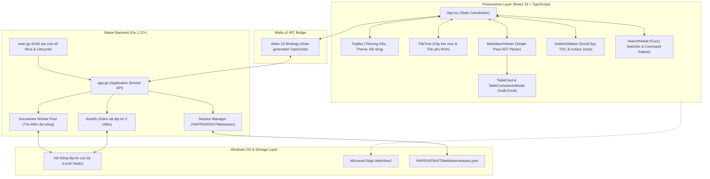
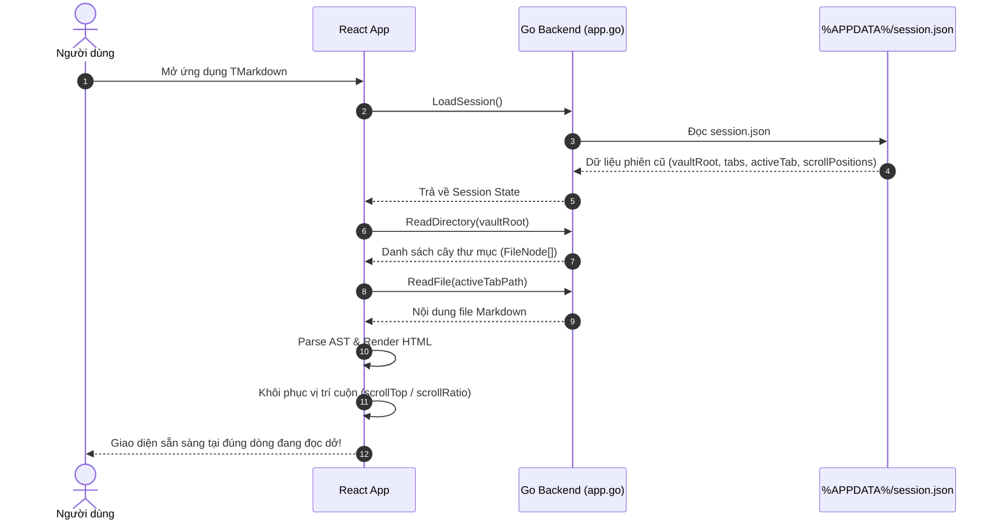
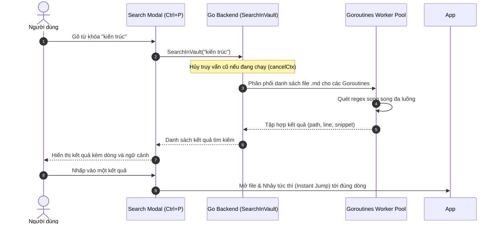

# Kiến Trúc Kỹ Thuật Hệ Thống TMarkdown 🏗️

Tài liệu này cung cấp cái nhìn toàn diện và chi tiết về cấu trúc kỹ thuật, luồng dữ liệu, và các giải pháp thiết kế đột phá của **TMarkdown** — ứng dụng đọc và quản lý Markdown hiệu năng cao xây dựng trên nền tảng **Go 1.22+ (Wails v2)** kết hợp **React 19 + TypeScript**.

---

## 1. Tổng Quan Kiến Trúc (High-Level Architecture)

TMarkdown áp dụng mô hình **Native Hybrid Architecture**:
- **Native Backend (Go)**: Đảm nhận các tác vụ nặng cần hiệu năng cấp hệ điều hành (I/O đĩa cứng, giám sát tệp tin theo thời gian thực, tìm kiếm đa luồng song song, quản lý phiên làm việc).
- **Presentation Layer (React 19 + TypeScript)**: Đảm nhận giao diện người dùng, kết xuất tài liệu Markdown tốc độ cao, điều hướng mượt mà và quản lý trạng thái hiển thị.
- **IPC Runtime Bridge (Wails v2)**: Cầu nối liên tiến trình (Inter-Process Communication) hiệu năng cao, cho phép Frontend gọi trực tiếp các phương thức Go như các hàm JavaScript bất đồng bộ (`Promise`).



---

## 2. Tầng Backend: Go & Wails Native Core

### 2.1. Quản lý Vòng đời & Cửa sổ Windows (`main.go`)
- Khởi tạo ứng dụng Wails với kích thước cửa sổ mặc định `1280×820` (kích thước tối thiểu `800×600`).
- Tích hợp hiệu ứng trong suốt hiện đại của Windows 11 (**Mica / Acrylic backdrop blur**) giúp ứng dụng tiệp màu với hệ điều hành.
- Gắn kết `app.go` (`App` struct) vào danh sách `Bind` của Wails để tự động tạo ra các TypeScript bindings trong `frontend/wailsjs/go/main/App.d.ts`.

### 2.2. Dịch vụ Hệ thống & Tệp tin (`app.go`)
Backend Go cung cấp các nhóm API chính:
1. **Quản lý Thư mục & Tệp tin**:
   - `OpenDirectory()`: Mở hộp thoại chọn thư mục Windows native (`runtime.OpenDirectoryDialog`).
   - `ReadDirectory(path)`: Đọc đệ quy cây thư mục, bỏ qua các thư mục ẩn hoặc rác (`.git`, `node_modules`, `.obsidian`, `.trash`).
   - `ReadFile(path)`, `WriteFile(path, content)`, `CreateFile(path)`, `DeleteFile(path)`: Đọc/ghi tệp tin văn bản an toàn với mã hóa UTF-8.
2. **Giám sát Tệp tin Hai chiều Thời gian thực (`fsnotify`)**:
   - Sử dụng thư viện `github.com/fsnotify/fsnotify` để theo dõi các sự kiện thêm, sửa, xóa, đổi tên file trong Vault.
   - Cơ chế Debouncing (giảm xung đột): Gom các sự kiện liên tiếp trong khoảng 150ms để tránh việc giao diện bị refresh dồn dập khi người dùng thực hiện thao tác Git pull hoặc giải nén nhiều file cùng lúc.
   - Khi có thay đổi từ bên ngoài (VS Code, Git, Syncthing), backend phát sự kiện `file-changed` hoặc `directory-changed` qua Wails Events tới Frontend.
3. **Tìm kiếm Đa luồng Siêu tốc (Goroutines Parallel Search)**:
   - Quét nội dung văn bản trên toàn bộ file `.md` trong Vault bằng Goroutine worker pool.
   - **Cơ chế Hủy tác vụ cũ (`context.WithCancel`)**: Mỗi khi người dùng gõ thêm một ký tự mới vào ô tìm kiếm, truy vấn cũ đang chạy sẽ lập tức bị hủy bỏ (cancel), giải phóng hoàn toàn CPU và RAM, không bao giờ gây nghẽn giao diện.
4. **Lưu vết Phiên làm việc (Session Persistence)**:
   - Tệp phiên làm việc được lưu tại `%APPDATA%/TMarkdown/session.json`.
   - Lưu trữ: đường dẫn Vault đang mở, danh sách tab đang mở, tab đang active, danh sách file yêu thích, lịch sử mở gần đây và vị trí cuộn trang.

---

## 3. Tầng Frontend: React 19 + TypeScript + Modern CSS Tokens

### 3.1. Single-Pass AST Markdown Parser (`markdownParser.ts`)
Thay vì parse nhiều lượt gây lãng phí CPU, TMarkdown áp dụng giải pháp **Single-Pass AST Parser**:
- Sử dụng `markdown-it` với các plugin cấu hình sẵn: syntax highlighting (`highlight.js`), Obsidian highlights (`==text==`), Obsidian Wiki-links (`[[Note]]`).
- **Thuật toán `HeadingSlugger`**:
  ```ts
  // Đảm bảo ID tiêu đề luôn duy nhất tuyệt đối
  export class HeadingSlugger {
    private occurrences = new Map<string, number>();
    public slug(text: string): string {
      const rawSlug = slugify(text);
      let count = this.occurrences.get(rawSlug) || 0;
      let slug = count > 0 ? `${rawSlug}-${count}` : rawSlug;
      while (this.occurrences.has(slug)) {
        count++;
        slug = `${rawSlug}-${count}`;
      }
      this.occurrences.set(rawSlug, count + 1);
      this.occurrences.set(slug, 1);
      return slug;
    }
  }
  ```
  Trong cùng một lượt duyệt AST token, vừa gán thuộc tính `id` chuẩn vào thẻ heading HTML, vừa trích xuất danh sách `HeadingItem[]` gửi sang Outline Sidebar. Không có bất kỳ phép lặp dư thừa nào.

### 3.2. Cỗ máy Ghi nhớ Cuộn Tuyệt đối (Scroll Memory Engine — `useScrollMemory.ts`)
- Lưu vết vị trí đọc theo cặp tọa độ:
  - `scrollTop`: Vị trí pixel tuyệt đối (phù hợp khi cửa sổ không đổi kích thước).
  - `scrollRatio = scrollTop / (scrollHeight - clientHeight)`: Tỷ lệ phần trăm từ 0.0 đến 1.0 (phục hồi hoàn hảo ngay cả khi người dùng thay đổi kích cỡ cửa sổ hoặc đổi cỡ chữ).
- Khi chuyển tab hoặc mở lại ứng dụng, hook tự động khôi phục tọa độ cuộn với độ chính xác 100%.
- **Scroll-Spy Lock Mechanism**: Khi người dùng click một mục trên Outline, hệ thống kích hoạt khóa chống rung 200ms (`scrollSpyLockedUntilRef = Date.now() + 200ms`), đảm bảo sự kiện cuộn tức thì không làm nhảy lung tung các nhánh mục lục trung gian.

### 3.3. Cỗ máy Xuất Dữ liệu Bảng Cho Excel (`tableExport.ts` & `TableCustomizerModal.tsx`)
- **Tự động bọc Table Card**: Mọi thẻ `<table>` được DOM wrapper tự động đóng gói trong container `.table-card`, với thanh tiêu đề `.table-card-header` cố định bên ngoài vùng cuộn ngang `overflow-x: auto`.
- **Định dạng Clipboard Kép (Dual MIME Format)**:
  ```ts
  const htmlBlob = new Blob([generateHtmlTable(...)], { type: 'text/html' });
  const textBlob = new Blob([generateTsv(...)], { type: 'text/plain' });
  await navigator.clipboard.write([
    new ClipboardItem({ 'text/html': htmlBlob, 'text/plain': textBlob })
  ]);
  ```
  - Khi dán vào Microsoft Excel hoặc Google Sheets: Phần mềm ưu tiên đọc `text/html`, tự động phân chia các cột/dòng, giữ nguyên định dạng in đậm và xuống dòng trong ô.
  - Khi dán vào Notepad hoặc Text Editor: Phần mềm đọc `text/plain` dạng TSV (phân cách bằng tab chuẩn).
- **Mã hóa UTF-8 BOM cho file CSV**: Ký tự byte `\uFEFF` được chèn vào đầu file `.csv` để Microsoft Excel trên Windows tự động nhận diện bảng mã Unicode tiếng Việt, không bị lỗi font khi mở trực tiếp.

### 3.4. Hệ thống Giao diện & Tokens CSS (`index.css`)
- Tuân thủ nguyên tắc **Zero-Tailwind**: 100% sử dụng Modern Vanilla CSS kết hợp CSS Custom Properties (`--bg-workspace`, `--text-primary`, `--accent-primary`, `--radius-md`).
- Hỗ trợ 2 chủ đề hoàn chỉnh:
  - **Dark Mode**: Phong cách Obsidian Deep kết hợp sắc tím Violet.
  - **Light Mode**: Thiết kế tương phản cao (High Contrast đạt chuẩn WCAG AAA > 7:1) tối ưu cho việc đọc lâu không mỏi mắt.
- **Hệ thống điều chỉnh độ rộng hiển thị (Content Width System)**:
  - `.width-standard`: `max-width: 840px`
  - `.width-wide`: `max-width: 1200px` (mặc định)
  - `.width-full`: `max-width: 100%`

---

## 4. Luồng Xử Lý Dữ Liệu Chính (Core Data Flows)

### 4.1. Khởi động Ứng dụng & Khôi phục Phiên làm việc (Session Restore)


### 4.2. Tìm kiếm Toàn bộ Kho Tài liệu (Global Vault Search)


---

## 5. Quy Chuẩn Đóng Gói & Triển Khai (Build & Distribution)

- **Môi trường phát triển**: `dev.ps1` hoặc `dev.bat` kích hoạt `wails dev` (kết hợp Vite HMR trên cổng nội bộ và WebView2 runtime).
- **Đóng gói phát hành**: `build.ps1` hoặc `build.bat` thực thi `wails build -clean`, nén tệp thực thi độc lập kèm các icon native (`build/windows/icon.ico`) thành tệp `release/TMarkdown-windows-x64.zip`.
- **Tự động hóa CI/CD**: Quy trình `.github/workflows/release.yml` tự động biên dịch và tạo GitHub Release khi một Git Tag (ví dụ `v1.1.0`) được push lên repository.
